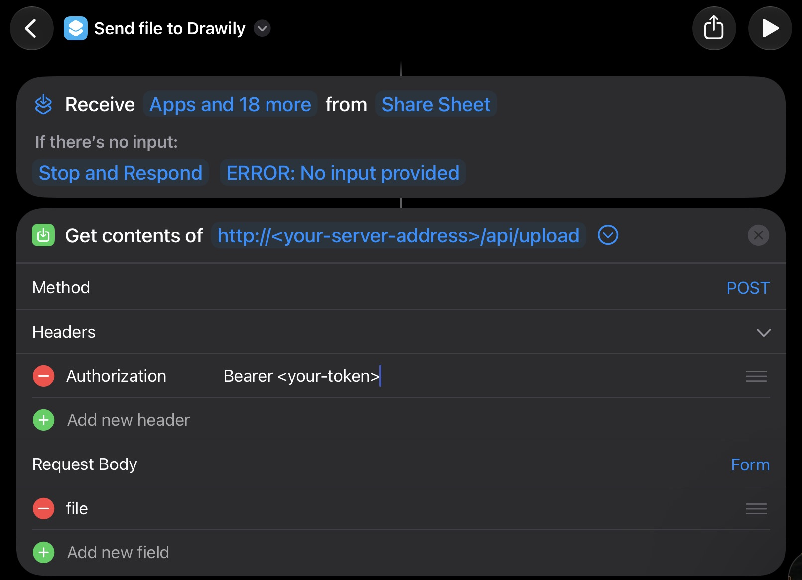

<h1 align="center">Drawily</h1>

Self-hosted tracker for (hopefully daily) drawings. Send your drawings from your device, archive them in your stack and always have an eye on when you draw last week, month or year.

I did ths project for two reasons, the first one was to have a tool that would allow me to track what I drew on a daily basis and help me with discipline in a visual way.

Having it in a self-hosted stack also makes it part of the backup system, and makes it accessible from the same places the rest of your stack is.

For the moment, it is really tailored to my personal use case (sending drawings from Procreate on an iPad), but I'll probably improve it with more functionalities and more ways to upload to it.

Second reason is detailed in the [AI disclosure](#ai-disclosure) :) 


See [CLAUDE.md](CLAUDE.md) for the stack and design decisions,
and [CONTRIBUTING.md](CONTRIBUTING.md) for the branch and release workflow.

---

## Current features

The project is in an early status as of right now, but got the very core features:

- **Upload:** Send your drawings to an API endpoint.

- **Preview:** See your drawings in a grid or timeline view with the dates, and have various file format under the same drawing.

- **Modify:** Split and Merge files from/to other drawings if things are mismatched.


> [!WARNING]
> This project doesn't have a multi-user system and security isn't the current priority. I heavily recommend that you <ins>DON'T</ins> leave it open to the internet, and access it through a VPN (like Tailscale, Netbird,...)

---

## Deploy it

This service is aimed to be containerized with Docker.

Either use the provided [docker-compose.yml](docker-compose.yml):

```bash
cp .env.example .env   # set APP_TOKEN, and PUID/PGID to the owner you want for the data
docker compose up -d
```

> [!WARNING]
> APP_TOKEN is mandatory for the service to run. It also is what you use to log in to the interface.

Which will build the image directly, or use the prebuilt image pulled from GitHub:

```yml
services:
  drawily:
    image: ghcr.io/KyoTensu/Drawily:latest
    env_file: .env
    ports:
      - "3000:3000"
    volumes:
      - drawily-data:/data
    restart: unless-stopped

volumes:
  drawily-data:
```

> [!NOTE]
> There are two main tags for docker images:
>
> - **latest** (recommended): points to the latest image built from the main branch. Built again when there's a new release, when I consider the new state of the project stable enough for me.
>
> - **staging:** points to the latest image built from the dev branch. Built again when there's modifications to the dev branch, when modifications are merged from a branch for a feature or fix, for instance. 

---

## Current personal usage

I use an iOS shortcut to send files directly from Procreate to the service. Here's a screenshot of the setup:



Then, from procreate, share the drawing of your choice and choose this shorcut as the destination.

> [!NOTE]
> This will be subject to change, as I get a better understanding of the iOS shotcut system, and add a way to upload from Drawily's UI.

> [!WARNING]
> Procreate and PSD formats can't be sent through the shortcut directly from Procreate, seemingly due to them being archive type files. For them, save the files to your storage, and share them to the shortcut from iOS's file browser.

---

## AI Disclosure

The second reason I've started this project was to learn about the use of LLMs in software development.

As a junior interested in NLP and agentic AI, I think it's important that I keep track of how the field evolves, and how these new tools works by trying them directly.

By doing this, I can see by myself what works, what doesn't and how much I can let the agents handle and still get something I'm happy with. 

There still are some parts that I'll do by hand. For instance, this README was written by myself to replace the default, tiny generated one. I'll probably also document the project by hand, and at least bring modifications to the Releases comments.

To be clear: As cool as it might look, it certainly is risky to follow an agent's work blindly, and anyone should be cautious with how they develop using these tools (or they could become more than "just a tool").

**I'm not currently happy with the effect of AI in artistic fields, and I'm still kind of worried of it's effect on society as a whole, but I hope the future will make me change my mind.**


I aslo kind of want to see how much I could like this way of developing or not, and adapt to it.


**tl,dr:**

> [!CAUTION]
> This project is heavily vibecoded. The vast majority of the code produced comes from LLMs.
>
> I read opened PRs to keep an eye on what's produced and I suggested part of the technologies used in the project.
>
> I make the documentation by hand to keep an hand in the project, and force myself to understand what's being built.
